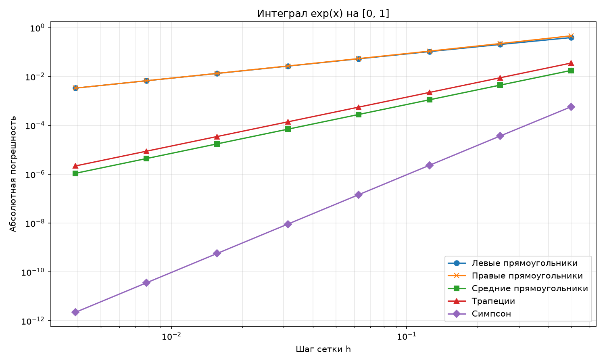

# Самостоятельная работа: численное интегрирование

Вычисляем $I=\int_0^1 e^x\,dx=e-1$.

Точное значение: **1.718281828459045**.
## Значения интеграла

| n | Левые | Правые | Средние | Трапеции | Симпсон |
| --- | --- | --- | --- | --- | --- |
| 2 | 1.324360635350064 | 2.183501549579587 | 1.700512716650208 | 1.753931092464825 | 1.718861151876593 |
| 4 | 1.512436676000136 | 1.942007133114897 | 1.713815279771087 | 1.727221904557517 | 1.718318841921747 |
| 8 | 1.613125977885612 | 1.827911206442992 | 1.717163664995687 | 1.720518592164302 | 1.718284154699897 |
| 16 | 1.665144821440649 | 1.772537435719340 | 1.718002192052660 | 1.718841128579995 | 1.718281974051892 |
| 32 | 1.691573506746655 | 1.745269813886000 | 1.718211913383859 | 1.718421660316327 | 1.718281837561771 |
| 64 | 1.704892710065258 | 1.731740863634930 | 1.718264349316863 | 1.718316786850094 | 1.718281829028015 |
| 128 | 1.711578529691060 | 1.725002606475896 | 1.718277458650162 | 1.718290568083478 | 1.718281828494606 |
| 256 | 1.714927994170611 | 1.721640032563029 | 1.718280736005365 | 1.718284013366820 | 1.718281828461267 |

## Абсолютные ошибки

Ошибка равна $E=|I_h-I|$.

| n | h | Левые | Правые | Средние | Трапеции | Симпсон |
| --- | --- | --- | --- | --- | --- | --- |
| 2 | 0.50000000 | 3.939212e-01 | 4.652197e-01 | 1.776911e-02 | 3.564926e-02 | 5.793234e-04 |
| 4 | 0.25000000 | 2.058452e-01 | 2.237253e-01 | 4.466549e-03 | 8.940076e-03 | 3.701346e-05 |
| 8 | 0.12500000 | 1.051559e-01 | 1.096294e-01 | 1.118163e-03 | 2.236764e-03 | 2.326241e-06 |
| 16 | 0.06250000 | 5.313701e-02 | 5.425561e-02 | 2.796364e-04 | 5.593001e-04 | 1.455928e-07 |
| 32 | 0.03125000 | 2.670832e-02 | 2.698799e-02 | 6.991508e-05 | 1.398319e-04 | 9.102726e-09 |
| 64 | 0.01562500 | 1.338912e-02 | 1.345904e-02 | 1.747914e-05 | 3.495839e-05 | 5.689702e-10 |
| 128 | 0.00781250 | 6.703299e-03 | 6.720778e-03 | 4.369809e-06 | 8.739624e-06 | 3.556067e-11 |
| 256 | 0.00390625 | 3.353834e-03 | 3.358204e-03 | 1.092454e-06 | 2.184908e-06 | 2.222000e-12 |

## Во сколько раз уменьшается ошибка

Сравниваем соседние сетки: $q=E(h)/E(h/2)$.

| Число интервалов | Левые | Правые | Средние | Трапеции | Симпсон |
| --- | --- | --- | --- | --- | --- |
| 2 -> 4 | 1.9137 | 2.0794 | 3.9783 | 3.9876 | 15.6517 |
| 4 -> 8 | 1.9575 | 2.0407 | 3.9945 | 3.9969 | 15.9113 |
| 8 -> 16 | 1.9790 | 2.0206 | 3.9986 | 3.9992 | 15.9777 |
| 16 -> 32 | 1.9895 | 2.0104 | 3.9997 | 3.9998 | 15.9944 |
| 32 -> 64 | 1.9948 | 2.0052 | 3.9999 | 4.0000 | 15.9986 |
| 64 -> 128 | 1.9974 | 2.0026 | 4.0000 | 4.0000 | 16.0000 |
| 128 -> 256 | 1.9987 | 2.0013 | 4.0000 | 4.0000 | 16.0039 |

## График

Обе оси логарифмические. График построен через Axes.loglog. Слева находятся меньшие шаги и меньшие ошибки. Левые и правые прямоугольники дают близкие по величине ошибки, поэтому их линии почти совпадают.

## Вывод

При делении шага пополам получаем:

- Левые и правые прямоугольники: ошибка уменьшается примерно в 2 раза, порядок O(h).
- Средние прямоугольники и трапеции: примерно в 4 раза, порядок O(h^2).
- Симпсон: примерно в 16 раз, порядок O(h^4).

Результаты согласуются с теорией. На выбранных сетках самый точный метод - Симпсон. Левые и средние прямоугольники занижают интеграл, остальные три метода в этом примере завышают его. Небольшое отклонение q от 16 на самой мелкой сетке связано с округлением чисел float.
