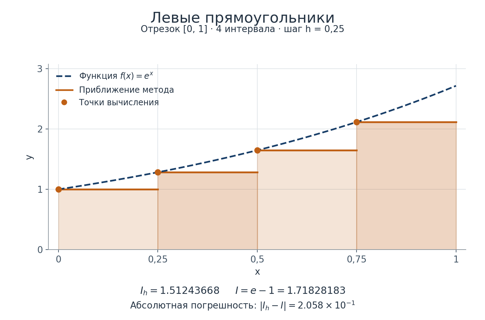
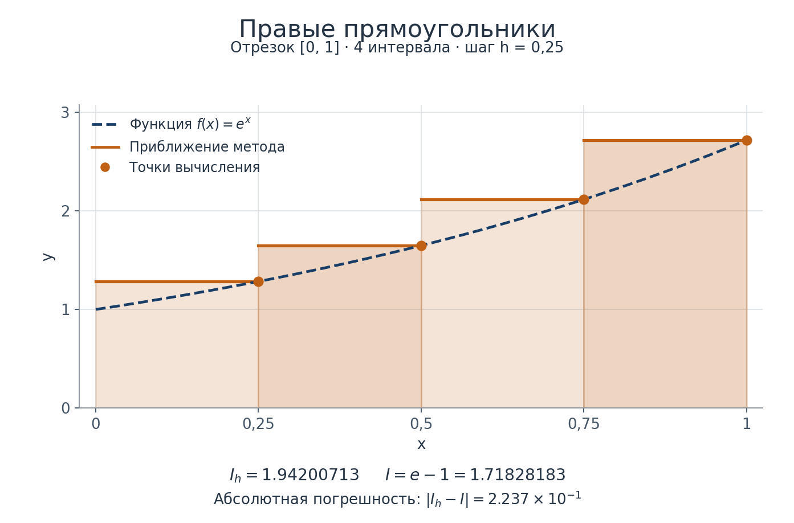
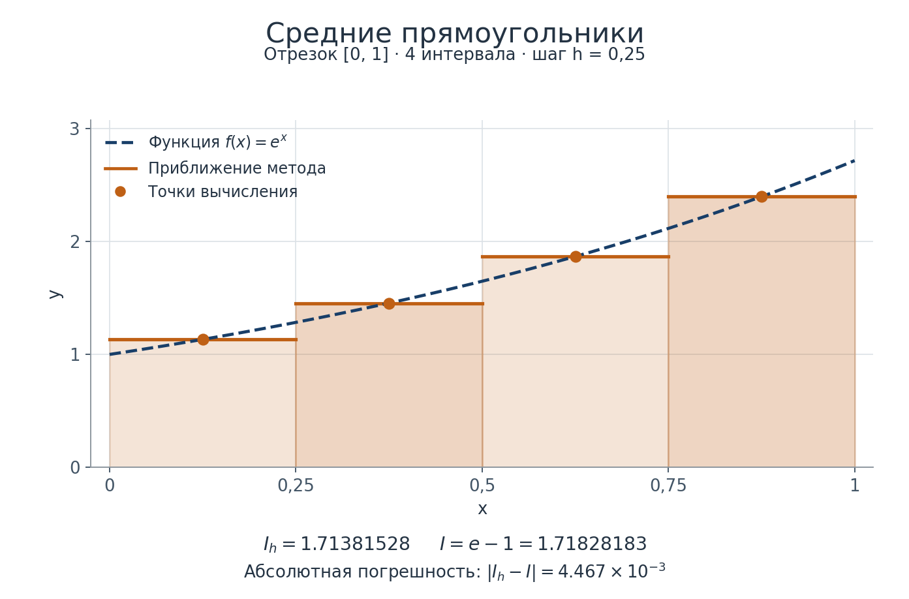
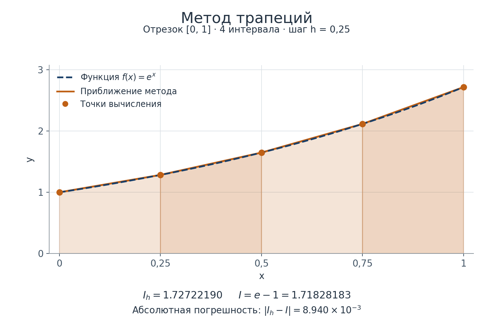
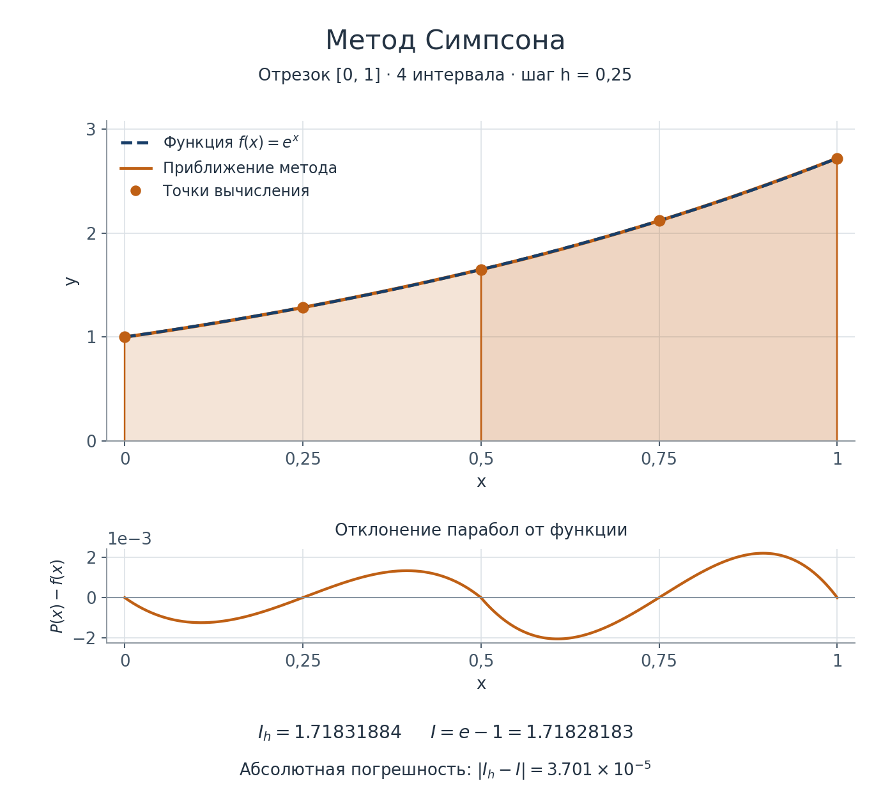

# Численное интегрирование: методы, собственный пакет и исследование погрешности

На предыдущих занятиях вы работали с функциями, собственными модулями, массивами NumPy и графиками Matplotlib. Теперь рассмотрим организацию модулей в пакет, вывод формул численного интегрирования и сравнение погрешностей методов.

## Собственные модули и пакет

**Модуль** — отдельный `.py`-файл. Например, в `rectangles.py` можно объединить три близких алгоритма. **Пакет** объединяет несколько модулей под общим именем. В этой работе используем обычный пакет: каталог `integration_methods` с файлом `__init__.py`.

### Для чего нужен `__init__.py`

Имя файла — именно `__init__.py`, с двумя подчёркиваниями с каждой стороны слова `init`. Файл относится ко всему пакету, а не к одному из его модулей. Для обычного пакета он выполняет две связанные задачи: участвует в загрузке пакета и определяет, какие имена доступны непосредственно через него.

Когда Python впервые импортирует обычный пакет в текущем процессе, он создаёт для него объект модуля и выполняет код `__init__.py`. Переменные, функции и импортированные имена из этого файла становятся атрибутами пакета. Последующие обычные импорты используют уже загруженный объект: этот файл не выполняется заново при каждом обращении к функции. Это происходит и при импорте вложенного модуля: сначала должен быть загружен содержащий его пакет.

Пустой `__init__.py` уже позволяет оформить каталог как обычный пакет. Но сам по себе он не собирает функции из всех соседних файлов. Если функция определена в `simpson.py`, к ней можно обратиться импортом из конкретного модуля:

```python
from integration_methods.simpson import integrate_simpson
```

Чтобы пользователь пакета мог импортировать эту функцию непосредственно из `integration_methods`, в `__init__.py` нужно явно импортировать её из `simpson.py`. Такой повторный экспорт предоставляет единое место доступа к выбранным функциям:

```python
from integration_methods import integrate_simpson
```

Реализация при этом остаётся в `simpson.py`. В `__init__.py` собираются имена, которые пакет предоставляет пользователям. Это позволяет хранить алгоритмы в разных модулях, а использовать их через общий интерфейс пакета.

В относительном импорте точка перед именем модуля означает обращение внутри текущего пакета. Например, `.simpson` в `integration_methods/__init__.py` обозначает модуль `integration_methods.simpson`. Такие импорты помогают связывать модули пакета между собой.

`__init__.py` является исполняемым Python-файлом. Поэтому в нём можно писать обычный код инициализации, но для нашего пакета достаточно описания, импортов и `__all__`. Вычисление интегралов, чтение пользовательского ввода и открытие графиков в нём были бы неожиданными побочными эффектами импорта. Эксперимент должен запускаться из `main.py`.

В Python существуют также пакеты пространств имён без `__init__.py`; для этой работы они не нужны. Подробнее — в [руководстве Python по пакетам](https://docs.python.org/3/tutorial/modules.html#packages).

### Для чего нужен `__all__`

`__all__` — список строк с именами, которые будут импортированы при использовании звёздочки. Он также явно перечисляет публичный интерфейс пакета для читателя кода. Если пакет повторно экспортирует функции и псевдонимы типов, их имена можно перечислить в этом списке.

Сам список не загружает объекты и не заменяет импорты: перечисленные функции и типы сначала должны стать доступны в пакете. `__all__` также не запрещает явно импортировать другие доступные имена и не делает их приватными.

В `main.py` используйте явные импорты: так видно, какие объекты нужны программе. Значение `__all__` при этом остаётся явным описанием публичного интерфейса. См. [объяснение `__all__` в документации Python](https://docs.python.org/3/tutorial/modules.html#importing-from-a-package).

## Функция как значение: `lambda`, `Callable` и псевдонимы типов

Имя функции без круглых скобок обозначает сам объект функции. Его можно сохранить в переменной, передать другому алгоритму и вызвать внутри него. Вызов функции с аргументом возвращает её результат — это другой объект.

Для короткой функции можно использовать `lambda`: после этого слова указываются параметры, затем двоеточие и одно выражение, результат которого возвращается при вызове. Более сложные функции с несколькими действиями удобнее определять через `def`.

Для аннотации вызываемых объектов используем `Callable` из `typing`. В записи `Callable[[float], float]` первый список задаёт типы аргументов, а последний элемент — тип результата. Это тип функции, принимающей одно вещественное число и возвращающей вещественное число.

Длинному выражению типа можно дать короткое имя — **псевдоним типа**. `Integrand` будет обозначать тип подынтегральной функции, а `IntegrationMethod` — тип алгоритма, принимающего массив узлов и подынтегральную функцию и возвращающего число. Для массива используем `NDArray[np.float64]` из `numpy.typing`.

Псевдоним типа не создаёт новую функцию и не вызывает существующую. Он помогает кратко записывать одинаковые аннотации в нескольких местах. Общие псевдонимы вынесем в модуль `type_aliases.py`, откуда их смогут импортировать и алгоритмы, и основной скрипт. Этот модуль не должен зависеть от `main.py` или от реализаций методов.

Аннотации помогают редактору и статическому анализатору проверять использование функций. При обычном выполнении Python не проверяет соответствие аргументов аннотациям автоматически. См. [псевдонимы типов в документации Python](https://docs.python.org/3/library/typing.html#type-aliases).

## Сетка и обозначения

Пусть нужно вычислить

$$
I = \int_a^b f(x)\,dx, \qquad a < b.
$$

Разделим отрезок на $n$ равных интервалов:

$$
h = \frac{b-a}{n}, \qquad x_i = a + ih, \qquad i=0,1,\ldots,n.
$$

Число узлов $N=n+1$. При фиксированных границах шаг равен

$$
h = \frac{b-a}{N-1}.
$$

[`np.linspace`](https://numpy.org/doc/stable/reference/generated/numpy.linspace.html) создаёт равномерную сетку по границам и **числу узлов**, а не числу интервалов. Обе границы входят в массив по умолчанию. Шаг также можно определить по двум соседним узлам.

Обозначим $f_i=f(x_i)$.

## Откуда берутся формулы: разложение Тейлора

### Общая идея

В окрестности точки $c$ достаточно гладкую функцию можно представить конечной формулой Тейлора:

$$
f(c+t) = f(c) + t f'(c) + \frac{t^2}{2}f''(c)
        + \frac{t^3}{6}f'''(c) + O(t^4).
$$

Будем интегрировать разложение на небольшом интервале и сопоставлять результат с суммой значений функции. Производные нужны **для объяснения формул и погрешностей**; вычислять их в программе не нужно.

Различайте два вида погрешности:

- **Локальная** — на одном интервале, а у Симпсона на одной паре интервалов.
- **Суммарная** — на всём фиксированном отрезке $[a,b]$.

Если локальная погрешность равна $O(h^{p+1})$ и таких участков порядка $1/h$, то суммарная погрешность ограничена величиной порядка $O(h^p)$. Оценки считаем равномерными по участкам; это обеспечивается ограниченностью нужных производных на отрезке. На специальных функциях погрешность может оказаться меньше или вообще равняться нулю.

На рисунках ниже показана одна и та же функция $f(x)=e^x$ на отрезке $[0,1]$. Сетка содержит пять узлов и четыре интервала, её шаг $h=0{,}25$. Синяя штриховая линия — исходная функция, оранжевая — приближение метода, точки отмечают места вычисления функции. Закрашенные площади суммируются для получения $I_h$. Под каждым рисунком приведены приближённое значение интеграла и его абсолютная погрешность.

### Левые прямоугольники



На интервале $[x_i,x_{i+1}]$ положим $x=x_i+t$, где $0\leq t\leq h$, и разложим функцию у левой границы:

$$
f(x_i+t)=f_i+O(h).
$$

Интегрируем по интервалу длиной $h$:

$$
\begin{aligned}
\int_{x_i}^{x_{i+1}} f(x)\,dx
&=\int_0^h \left(f_i+O(h)\right)dt \\
&=h f_i+O(h^2).
\end{aligned}
$$

Оставляем первый член. Получается площадь прямоугольника шириной $h$ и высотой $f_i$:

$$
L_i=h f_i.
$$

Локальная погрешность — $O(h^2)$, суммарная — $O(h)$. Формула на всём отрезке:

$$
\boxed{L_h=h\sum_{i=0}^{n-1} f(x_i).}
$$

Правая граница $x_n$ в сумму не входит. Для возрастающей экспоненты левые прямоугольники дают значение меньше точного интеграла.

### Правые прямоугольники



Теперь разложим функцию у правой границы $x_{i+1}$, положив $x=x_{i+1}-t$, где $0\leq t\leq h$:

$$
f(x_{i+1}-t)=f(x_{i+1})+O(h).
$$

Тогда

$$
\begin{aligned}
\int_{x_i}^{x_{i+1}} f(x)\,dx
&=\int_0^h \left(f(x_{i+1})+O(h)\right)dt \\
&=h f(x_{i+1})+O(h^2).
\end{aligned}
$$

Оставляя первый член, получаем

$$
R_i=h f(x_{i+1}), \qquad
\boxed{R_h=h\sum_{i=1}^{n} f(x_i).}
$$

Здесь левая граница $x_0$ в сумму не входит. Порядки погрешности те же: локально $O(h^2)$, на всём отрезке $O(h)$. Для возрастающей экспоненты результат больше точного интеграла.

### Средние прямоугольники



Для средних прямоугольников нужны середины интервалов:

$$
m_i = \frac{x_i+x_{i+1}}{2}.
$$

Это дополнительные точки вычисления функции: они не обязаны присутствовать в исходном массиве узлов.

Разложим функцию у середины $m=m_i$. Теперь $-h/2\leq t\leq h/2$:

$$
f(m+t)=f(m)+t f'(m)+\frac{t^2}{2}f''(m)
       +\frac{t^3}{6}f'''(m)+O(t^4).
$$

Интегралы нечётных степеней $t$ на симметричном отрезке равны нулю. Поэтому

$$
\begin{aligned}
\int_{x_i}^{x_{i+1}} f(x)\,dx
&=h f(m)+\frac{f''(m)}{2}\int_{-h/2}^{h/2}t^2\,dt+O(h^5) \\
&=h f(m)+\frac{h^3}{24}f''(m)+O(h^5) \\
&=h f(m)+O(h^3).
\end{aligned}
$$

Оставляем площадь прямоугольника с высотой в середине интервала:

$$
M_i=h f(m_i), \qquad
\boxed{M_h=h\sum_{i=0}^{n-1} f\left(\frac{x_i+x_{i+1}}{2}\right).}
$$

Благодаря симметрии член с первой производной исчез. Локальная погрешность теперь $O(h^3)$, суммарная — $O(h^2)$. Замена левой точки на середину повышает порядок метода, хотя число прямоугольников не меняется.

### Трапеции



Заменим график на каждом интервале отрезком прямой, соединяющим значения на его концах. Найдём формулу через то же разложение у середины $m=m_i$:

$$
f(x_i)=f(m)-\frac{h}{2}f'(m)+\frac{h^2}{8}f''(m)
        -\frac{h^3}{48}f'''(m)+O(h^4).
$$

$$
f(x_{i+1})=f(m)+\frac{h}{2}f'(m)+\frac{h^2}{8}f''(m)
        +\frac{h^3}{48}f'''(m)+O(h^4).
$$

В среднем арифметическом значений нечётные члены сокращаются:

$$
\frac{f(x_i)+f(x_{i+1})}{2}
=f(m)+\frac{h^2}{8}f''(m)+O(h^4).
$$

Умножим на ширину интервала:

$$
T_i=\frac{h}{2}\left(f(x_i)+f(x_{i+1})\right)
   =h f(m)+\frac{h^3}{8}f''(m)+O(h^5).
$$

Сравним с точным интегралом из предыдущего вывода:

$$
T_i-\int_{x_i}^{x_{i+1}}f(x)\,dx
=\left(\frac18-\frac1{24}\right)h^3 f''(m)+O(h^5)
=\frac{h^3}{12}f''(m)+O(h^5).
$$

Таким образом,

$$
\begin{aligned}
\int_{x_i}^{x_{i+1}}f(x)\,dx
&=T_i-\frac{h^3}{12}f''(m)+O(h^5) \\
&=\frac{h}{2}\left(f(x_i)+f(x_{i+1})\right)+O(h^3).
\end{aligned}
$$

Следовательно, локальная погрешность — $O(h^3)$, суммарная — $O(h^2)$. Складывая площади трапеций, получаем

$$
\boxed{T_h=h\left(\frac{f_0}{2}+\sum_{i=1}^{n-1}f_i+\frac{f_n}{2}\right).}
$$

Внутренние узлы принадлежат двум соседним трапециям, поэтому их суммарный вес равен $1$. Крайние узлы входят только в одну трапецию и имеют вес $1/2$. Для выпуклой экспоненты трапеции завышают интеграл, а средние прямоугольники занижают его.

### Метод Симпсона (метод парабол)



На рисунке закрашены два участка под разными параболами: каждый охватывает два интервала сетки. На основном графике параболы почти совпадают с экспонентой, поэтому ниже отдельно показана разность $P(x)-f(x)$, без увеличения или искажения самих площадей.

**Метод Симпсона**, или **метод парабол**, использует квадратный многочлен, проходящий через три соседних значения функции. В отличие от трапеций, один участок метода охватывает **два** интервала сетки.

Возьмём точки $m-h$, $m$, $m+h$. Здесь $h$ по-прежнему означает расстояние между соседними узлами; длина всего рассматриваемого участка равна $2h$.

Положим $t=x-m$ и заменим функцию параболой

$$
P(t)=A+Bt+Ct^2.
$$

Подберём коэффициенты так, чтобы парабола проходила через три значения функции:

$$
\begin{cases}
A-Bh+Ch^2=f(m-h), \\
A=f(m), \\
A+Bh+Ch^2=f(m+h).
\end{cases}
$$

Вычитая первое уравнение из третьего, получаем $B$. Складывая их и учитывая среднее уравнение, находим $C$:

$$
A=f(m), \qquad
B=\frac{f(m+h)-f(m-h)}{2h}, \qquad
C=\frac{f(m-h)-2f(m)+f(m+h)}{2h^2}.
$$

Теперь точно проинтегрируем параболу на участке $[-h,h]$. Член $Bt$ нечётный, поэтому его интеграл равен нулю:

$$
\begin{aligned}
\int_{-h}^{h}P(t)\,dt
&=2hA+\frac{2h^3}{3}C \\
&=2h f(m)+\frac{h}{3}\left(f(m-h)-2f(m)+f(m+h)\right) \\
&=\frac{h}{3}\left(f(m-h)+4f(m)+f(m+h)\right).
\end{aligned}
$$

Заменяя интеграл функции интегралом этой параболы, получаем формулу Симпсона на паре интервалов:

$$
\boxed{S=\frac{h}{3}\left(f(m-h)+4f(m)+f(m+h)\right).}
$$

Для оценки погрешности воспользуемся разложением Тейлора относительно $m$. Как и у средних прямоугольников, нечётные степени при интегрировании сокращаются:

$$
J=\int_{m-h}^{m+h}f(x)\,dx
 =2h f(m)+\frac{h^3}{3}f''(m)+O(h^5).
$$

В то же время

$$
f(m-h)+f(m+h)=2f(m)+h^2 f''(m)+O(h^4),
$$

поэтому

$$
S=\frac{h}{3}\left(6f(m)+h^2 f''(m)+O(h^4)\right)
 =2h f(m)+\frac{h^3}{3}f''(m)+O(h^5).
$$

Оба явно выписанных члена совпадают. Следовательно,

$$
\int_{m-h}^{m+h}f(x)\,dx
=\frac{h}{3}\left(f(m-h)+4f(m)+f(m+h)\right)+O(h^5).
$$

Локальная погрешность на паре интервалов равна $O(h^5)$. Пар на фиксированном отрезке порядка $1/h$, поэтому суммарная погрешность равна $O(h^4)$.

Если $n$ чётно, сложим формулы по парам $[x_0,x_2]$, $[x_2,x_4]$, ..., $[x_{n-2},x_n]$:

$$
\boxed{
S_h=\frac{h}{3}\left(
f_0
+4\sum_{j=1}^{n/2}f_{2j-1}
+2\sum_{j=1}^{n/2-1}f_{2j}
+f_n
\right).
}
$$

Веса узлов идут в порядке $1,4,2,4,2,\ldots,4,1$. Внутренние узлы с чётными индексами являются общими границами соседних пар и поэтому получают вес $2$.

Число интервалов $n$ должно быть чётным, а число узлов $N=n+1$ — нечётным. Индексы в формулах начинаются с нуля, как и индексы массива Python.

Хотя строится квадратный многочлен, Симпсон точно интегрирует и любой кубический многочлен: его разложение Тейлора заканчивается на третьей степени, а нечётные члены учитываются точно благодаря симметрии. В вычислениях с `float` возможны небольшие остатки округления.

Составные формулы трапеций и Симпсона и стандартные оценки их погрешностей приведены также в [NIST DLMF, раздел «Quadrature»](https://dlmf.nist.gov/3.5).

### Сравнение порядков

| Метод | Локальная погрешность | Суммарная погрешность | Во сколько раз обычно уменьшается погрешность при делении $h$ пополам |
| --- | --- | --- | --- |
| Левые прямоугольники | $O(h^2)$ | $O(h)$ | Примерно в 2 раза. |
| Правые прямоугольники | $O(h^2)$ | $O(h)$ | Примерно в 2 раза. |
| Средние прямоугольники | $O(h^3)$ | $O(h^2)$ | Примерно в 4 раза. |
| Трапеции | $O(h^3)$ | $O(h^2)$ | Примерно в 4 раза. |
| Симпсон | $O(h^5)$ на паре интервалов | $O(h^4)$ | Примерно в 16 раз. |

Соотношения в последнем столбце ожидаются при поведении $E(h)\approx C h^p$ с ненулевым ведущим коэффициентом, достаточно малом шаге и ещё несущественном влиянии округления. Запись $O(h^p)$ сама по себе не утверждает точного равенства погрешности величине $C h^p$.

## Как сравнивать погрешности на графике

Если известен точный интеграл $I$, абсолютная погрешность приближения $I_h$ равна

$$
E(h)=|I_h-I|.
$$

Для сравнения методов удобно откладывать по горизонтали шаг $h$, а по вертикали — погрешность $E(h)$, используя логарифмический масштаб обеих осей. Если

$$
E(h)\approx C h^p,
$$

то

$$
\log E\approx\log C+p\log h.
$$

В логарифмических координатах получается почти прямая с наклоном $p$. Поэтому методы первого, второго и четвёртого порядков можно различать по наклону линий. При обычном направлении горизонтальной оси меньшие шаги находятся слева: именно туда погрешность должна убывать. Обычный линейный масштаб затрудняет сравнение, когда погрешности различаются на много порядков.

В Matplotlib для такого графика есть [`Axes.loglog`](https://matplotlib.org/stable/api/_as_gen/matplotlib.axes.Axes.loglog.html). Он строит линии как `plot`, но сразу задаёт оба логарифмических масштаба.

Для сохранения изображения при необходимости используется [`Figure.savefig`](https://matplotlib.org/stable/api/_as_gen/matplotlib.figure.Figure.savefig.html), вызываемый через `fig.savefig`. Сохранение графика в файл в этом задании необязательно.

Логарифм нуля не определён. Точки с нулевой погрешностью нельзя показывать на такой оси; заменять ноль произвольным маленьким числом тоже не следует. На многочленах Симпсон может дать точный результат с учётом округления, поэтому для исследования сходимости лучше выбрать функцию, на которой погрешность метода не обращается в ноль автоматически.

Кроме погрешности самой формулы есть округление при вычислении функции, суммировании и сравнении с численным представлением точного ответа. Поэтому очень мелкая сетка не гарантирует дальнейшего уменьшения вычисленной погрешности.

## Самостоятельная работа

Вычислите интеграл

$$
I = \int_0^1 e^x\,dx = e - 1
$$

методами левых, правых и средних прямоугольников, методом трапеций и методом Симпсона. Реализуйте методы самостоятельно, оформите их в пакет по структуре ниже и сравните их погрешности при уменьшении шага сетки вдвое.

Требования к работе:

- В `main.py` сохраните подынтегральную функцию в переменную типа `Integrand`, используя `lambda`. Создавайте сетки через `np.linspace`, задавая границы, число узлов и тип `np.float64`. Для переменных, хранящих методы интегрирования, используйте `IntegrationMethod`.
- Каждый метод принимает одномерный массив координат узлов и подынтегральную функцию, возвращает обычный `float`. Считайте сетку равномерной и возрастающей. Для прямоугольников и трапеций нужны хотя бы два узла, для Симпсона — нечётное число узлов, не меньше трёх. Подынтегральная функция принимает одно число, а не массив.
- Используйте общие псевдонимы типов и явные импорты из собственного пакета. Готовые функции численного интегрирования NumPy и SciPy использовать нельзя.
- Представьте таблицу результатов и общий график абсолютной погрешности пяти методов от шага сетки в логарифмических координатах. У графика должны быть подписи, легенда и сетка. Для построения используйте `Axes.loglog`.
- Кратко объясните, согласуются ли результаты с теоретическими порядками погрешности и во сколько раз уменьшается погрешность при делении шага пополам.

Проверки корректности, организацию расчётов и способ хранения результатов продумайте самостоятельно.

### Структура программы

```text
main.py
integration_methods/
    __init__.py
    type_aliases.py
    rectangles.py
    trapezoid.py
    simpson.py
```

`rectangles.py` содержит три метода прямоугольников, `trapezoid.py` — метод трапеций, `simpson.py` — метод Симпсона. `type_aliases.py` содержит общие псевдонимы типов. В `__init__.py` собирается публичный интерфейс пакета. В `main.py` располагаются вычислительный эксперимент и визуализация.

### Общие псевдонимы типов

Полное содержимое файла `integration_methods/type_aliases.py`, который нужно создать в своей работе:

```python
"""Псевдонимы типов для функций численного интегрирования."""

# System imports
from typing import Callable

# External imports
import numpy as np
from numpy.typing import NDArray

# User imports

#############################################


Integrand = Callable[[float], float]
IntegrationMethod = Callable[[NDArray[np.float64], Integrand], float]
```

В модулях с алгоритмами импортируйте `Integrand` непосредственно из `.type_aliases`. Остальные типы в их сигнатурах — `NDArray` из `numpy.typing` и `np.float64` из NumPy. В `main.py` оба псевдонима доступны через пакет благодаря импортам в `__init__.py`.

### Полное содержимое `integration_methods/__init__.py`

```python
"""Методы численного интегрирования на равномерной сетке.

Экспортируемые объекты:
    Integrand: Тип подынтегральной функции.
    IntegrationMethod: Тип метода интегрирования.
    integrate_left_rectangles: Метод левых прямоугольников.
    integrate_midpoint_rectangles: Метод средних прямоугольников.
    integrate_right_rectangles: Метод правых прямоугольников.
    integrate_trapezoid: Метод трапеций.
    integrate_simpson: Метод Симпсона.
"""

# System imports
from typing import List

# External imports

# User imports
from .rectangles import (
    integrate_left_rectangles,
    integrate_midpoint_rectangles,
    integrate_right_rectangles,
)
from .simpson import integrate_simpson
from .trapezoid import integrate_trapezoid
from .type_aliases import Integrand, IntegrationMethod

#############################################


__all__: List[str] = [
    "Integrand",
    "IntegrationMethod",
    "integrate_left_rectangles",
    "integrate_midpoint_rectangles",
    "integrate_right_rectangles",
    "integrate_trapezoid",
    "integrate_simpson",
]
```

Обратите внимание на зависимости: модули алгоритмов импортируют типы из `.type_aliases`, а `__init__.py` импортирует публичные объекты из этих модулей. Сам модуль типов не импортирует алгоритмы. Так для определения типов не требуется обратное обращение к ещё загружаемому интерфейсу пакета.

### Сигнатуры методов

Ниже приведены только сигнатуры. Многоточие обозначает место для вашей реализации; документацию функций также напишите самостоятельно.

В `rectangles.py`:

```python
def integrate_left_rectangles(
    nodes: NDArray[np.float64],
    function: Integrand,
) -> float:
    ...


def integrate_right_rectangles(
    nodes: NDArray[np.float64],
    function: Integrand,
) -> float:
    ...


def integrate_midpoint_rectangles(
    nodes: NDArray[np.float64],
    function: Integrand,
) -> float:
    ...
```

В `trapezoid.py`:

```python
def integrate_trapezoid(
    nodes: NDArray[np.float64],
    function: Integrand,
) -> float:
    ...
```

В `simpson.py`:

```python
def integrate_simpson(
    nodes: NDArray[np.float64],
    function: Integrand,
) -> float:
    ...
```

## Документация

- [Модули, пакеты, относительные импорты и `__all__` в руководстве Python](https://docs.python.org/3/tutorial/modules.html).
- [Типизация функций через `typing.Callable`](https://docs.python.org/3/library/typing.html#typing.Callable) и [псевдонимы типов](https://docs.python.org/3/library/typing.html#type-aliases).
- [`numpy.typing.NDArray`](https://numpy.org/doc/stable/reference/typing.html#numpy.typing.NDArray).
- [`numpy.linspace`](https://numpy.org/doc/stable/reference/generated/numpy.linspace.html).
- [`Axes.loglog`](https://matplotlib.org/stable/api/_as_gen/matplotlib.axes.Axes.loglog.html).
- [NIST DLMF: формулы численного интегрирования](https://dlmf.nist.gov/3.5).
